<p align="center">
  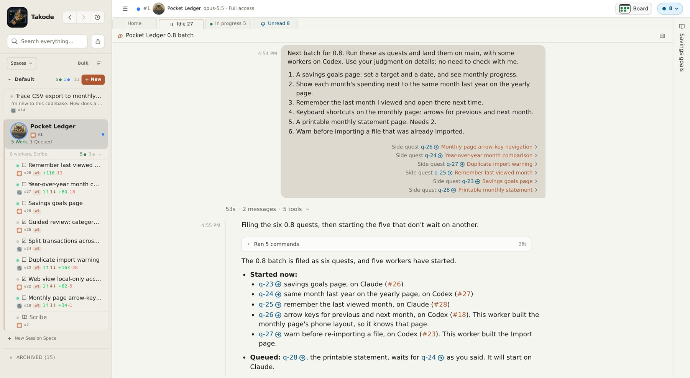
</p>

<h1 align="center">Takode</h1>
<p align="center"><strong>Lead a team of Claude Code and Codex agents, not a wall of chats.</strong></p>
<p align="center">
  <a href="#quick-start"><strong>Quick Start</strong></a> ·
  <a href="docs/remote-hosts.md">Other machines</a> ·
  <a href="web/src/glossary/glossary.md">Glossary</a>
</p>

<p align="center">
  <a href="LICENSE"></a>
</p>

## Why Takode

In Takode you talk to a few leader sessions. They turn your requests into quests, run workers in parallel, decide what waits for what, land the changes, and come back only with decisions and results. Every quest leaves a record, and what the agents learn goes into a memory they read next time.

Running several coding agents side by side is no longer rare: plenty of apps give you parallel sessions, git worktrees, a diff view and your phone. Takode has all of that, and it runs the real Claude Code and Codex CLIs, so you keep their models, tools and behavior. What it adds is what a team of agents needs to keep working on one project for weeks without you holding it together:

- **Leaders run the work.** A leader files each request as a quest, picks or starts a worker, queues a batch with its dependencies, reviews what comes back, and asks you only when the call is yours.
- **Every piece of work leaves a record.** Each quest keeps what was asked, what was decided, its commits and a final summary, so "why did we do it this way?" has an answer months later.
- **Memory that grows with the project.** Lessons go into Git-tracked Markdown notes that later sessions read before related work.
- **Built for many agents on one codebase.** A landing queue tests waiting changes together before they land, and leases make agents take turns on dev servers, browsers and build machines.
- **Only the decisions reach you.** Questions come with their context and suggested replies, in the thread they are about, and a bell collects them across all your leaders.
- **One workspace across your machines.** One Takode keeps every session, quest and note, while sessions run on whichever machine holds the code or the GPU.

---

## A Leader at Work

Say you hand a leader five bug reports before lunch. It files five quests, starts three workers, and holds the two that touch the same code until the first is done. Halfway through it asks you to choose between two fixes. After lunch you read five short summaries, each linking its commits.

**1. Ask.** Describe a bug, paste a screenshot, or point at an existing quest. The leader writes it up as a quest, starts a worker in its own worktree, and keeps your conversation in a thread for that quest. A live card shows the worker's latest steps without opening its session.

<p align="center">
  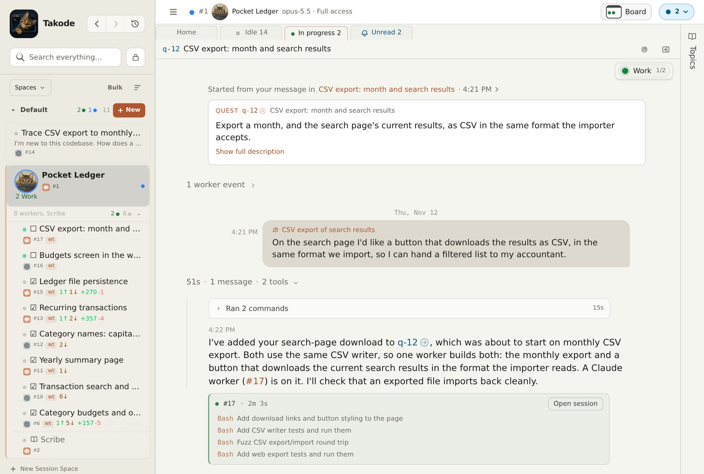
</p>

**2. Decide when asked.** When the work needs your call (a design choice, an approval, a missing detail), the leader explains the situation and asks with suggested replies. Only that quest waits; everything else keeps moving. Follow-ups, reviews and retries happen between agents.

<p align="center">
  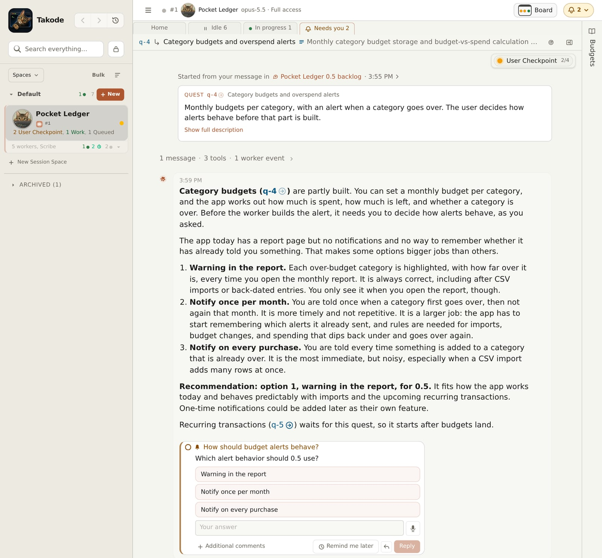
</p>

**3. Review the result.** The leader reports what changed and why, and links the exact commits. Each commit opens in a compact diff view.

<p align="center">
  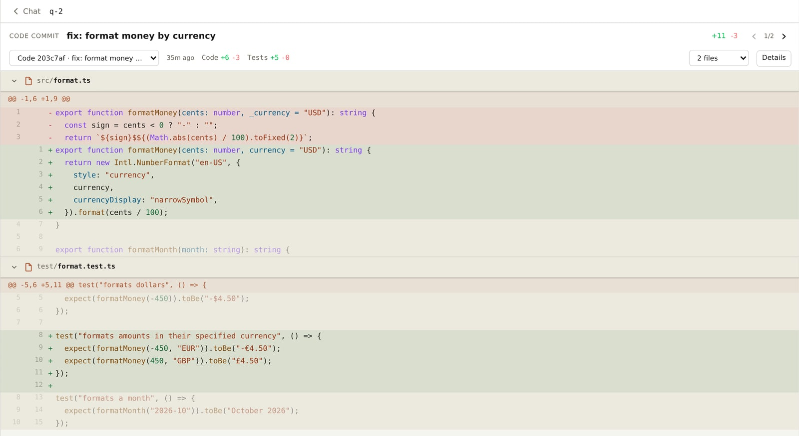
</p>

## Leaders Run the Work

A leader does more than hand out tasks: it manages a team over time.

- **A Work Board for batches.** Hand a leader a list of tasks. It queues them, holds each one until a worker is free or the quests it depends on are done, then starts it.
- **It hears everything its workers do.** When a worker finishes a turn, asks a question or stalls, its leader is told. It checks the result, sends the worker back when something is missing, and moves the quest on.
- **Workers keep their context.** A leader can give a follow-up to the worker that already knows the code instead of starting from scratch.
- **Jump in any time.** Every worker is an ordinary Claude Code or Codex session you can open to inspect what it is doing and steer it directly. Or reply in the quest's thread and the leader passes it on with the context the worker needs.

<p align="center">
  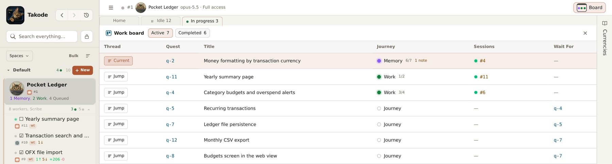
</p>

## A Record of Every Piece of Work

A quest is a durable task: who owns it, what was decided, and what shipped. Each one follows a short Journey: **Work** (investigate, build, test and publish), a **User Checkpoint** whenever it waits for your answer, and **Memory** (record what future sessions should know). Every phase leaves a short summary for you and fuller notes for later agents. When a quest needs another pass, it reopens for a new round in the same thread.

<p align="center">
  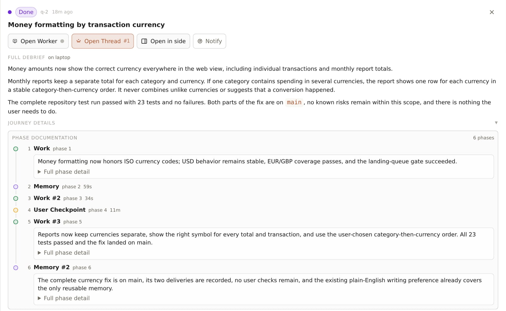
</p>

Questmaster lists every quest, and search finds them by what they say, so you, or a leader you ask, can trace a decision back to the quest that made it.

<p align="center">
  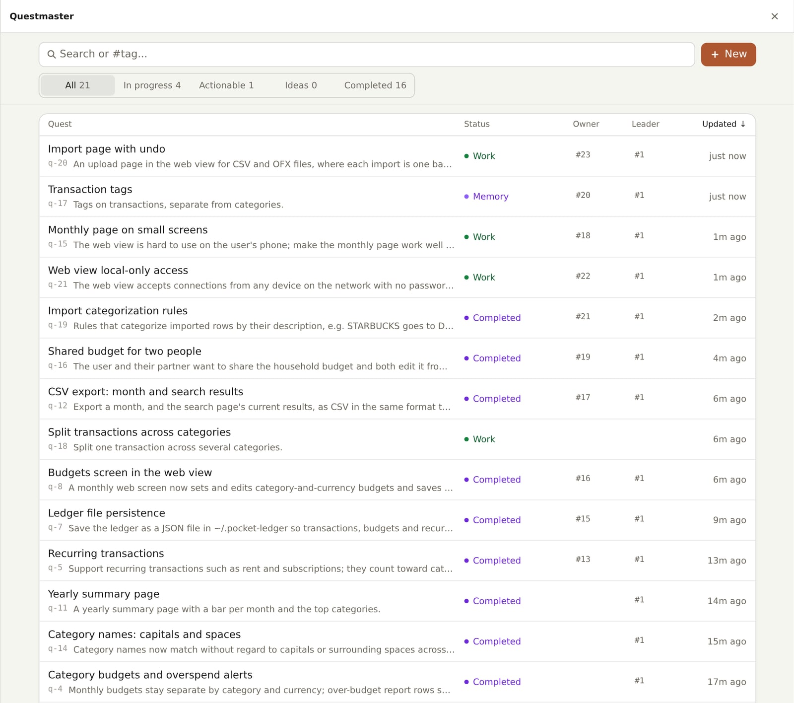
</p>

## Memory That Grows with the Project

Lessons that matter beyond one quest go into a Git-tracked repo of plain Markdown notes, filed in topic folders. Before related work, sessions read the matching folder, so the fix for a tricky build step or the reason behind a design choice is not rediscovered every week. There is no hidden model memory: just notes you can browse, edit and diff. Separate session spaces (groups of sessions, such as work and personal) keep separate memories.

<p align="center">
  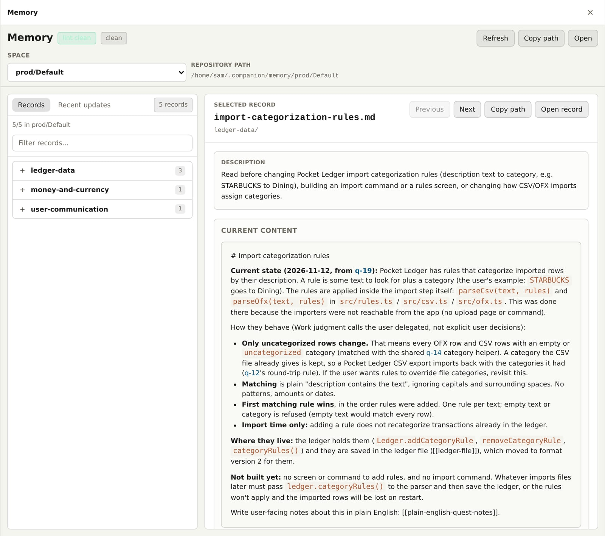
</p>

Corrections can stick too. When you correct an agent and the lesson is general, it can propose a change to its instructions or skills so the mistake does not come back. Takode keeps your own instructions and skills in one place and puts them on every machine your sessions run on.

## Many Agents, One Codebase

Parallel agents are easy to start and hard to keep from tripping over each other. Takode has the plumbing for that:

- **Landing queue.** On a shared branch, finished changes wait in a queue, are tested together, and land. When a batch fails, Takode narrows it down to the change that broke it and lands the rest. Workers are free as soon as they submit.
- **Worktree isolation.** Each worker gets its own git worktree and branch, and finished worktrees are cleaned up safely.
- **Leases for shared resources.** Agents take turns on dev servers and browsers, and share a machine's capacity for builds and test runs, instead of fighting over them.
- **Waiting that costs nothing.** An agent waiting on a long job sets a timer with a check command. Takode runs the check on schedule and wakes the agent only when the job is done.

## Only the Decisions Reach You

- **Questions with context.** A question arrives as a normal explanation followed by a short card with suggested replies, in the thread of the quest it is about.
- **Threads and Home.** Every conversation with a leader is a thread. A leader opens on Home, which lists its threads with a line of news each and pins anything waiting for you on top. A background helper, the Scribe, names threads and files them under topics.
- **One bell for everything.** The bell at the top gathers every leader's questions and unread results, and its Next button steps through them in order. You can also ask to be told when one particular quest finishes.
- **Away from the screen.** Phone alerts come through Web Push or Pushover, and Takode can read new answers aloud as they arrive.

## Results You Can Read

Not everything an agent produces is a diff. Reports, slide decks, figures and drafts land in the Library, and you can comment on any passage to send feedback to the agent that wrote it. Ask for a code review and you get a guided walkthrough of the change that puts the questions needing your call first. A Slack message or PR comment an agent drafts for you shows as a card with a Copy button, ready to paste.

<p align="center">
  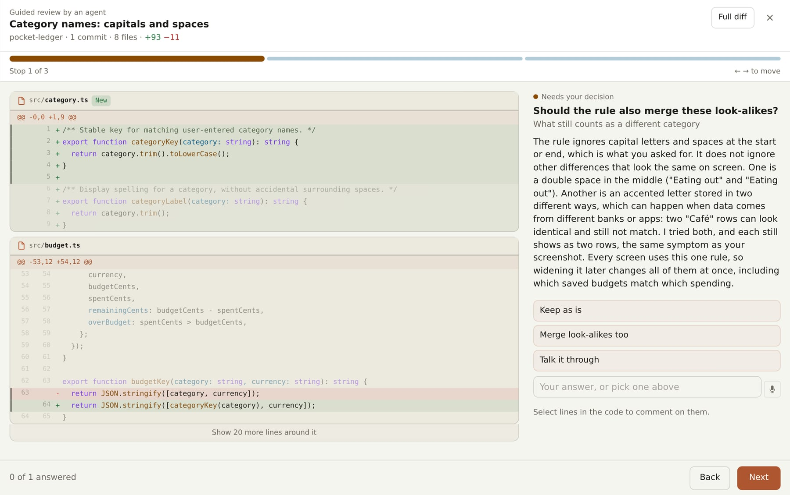
</p>

## One Workspace Across Your Machines

Some work belongs somewhere else: the cloud workspace where a big repo lives, or the GPU box next to the data. One Takode server keeps every session, quest, Work Board and note, and each other machine runs `takode node` to host sessions near its files.

- **Leaders work across machines.** A leader can start a worker on any registered machine and coordinate it like any other: same quests, same inbox, same reviews.
- **Work happens where the files are.** Worktrees, Git status, diffs and terminals run on the session's own machine.
- **Nothing to open up.** The node dials out to the server over HTTPS or an SSH tunnel, with a revocable token per machine. Each machine keeps its own agent logins.
- **Steady over flaky links.** Sessions keep running through network drops, host sleep and server restarts, and turns that lose the model API pause and continue once the network is back.

Setup takes a Takode checkout on each machine and a few commands; see [Running sessions on another machine](docs/remote-hosts.md).

---

## Starting a Session

Starting a session takes a few clicks: pick Claude Code or Codex, a folder, a base branch, and whether the session should be a leader or work in its own worktree.

<p align="center">
  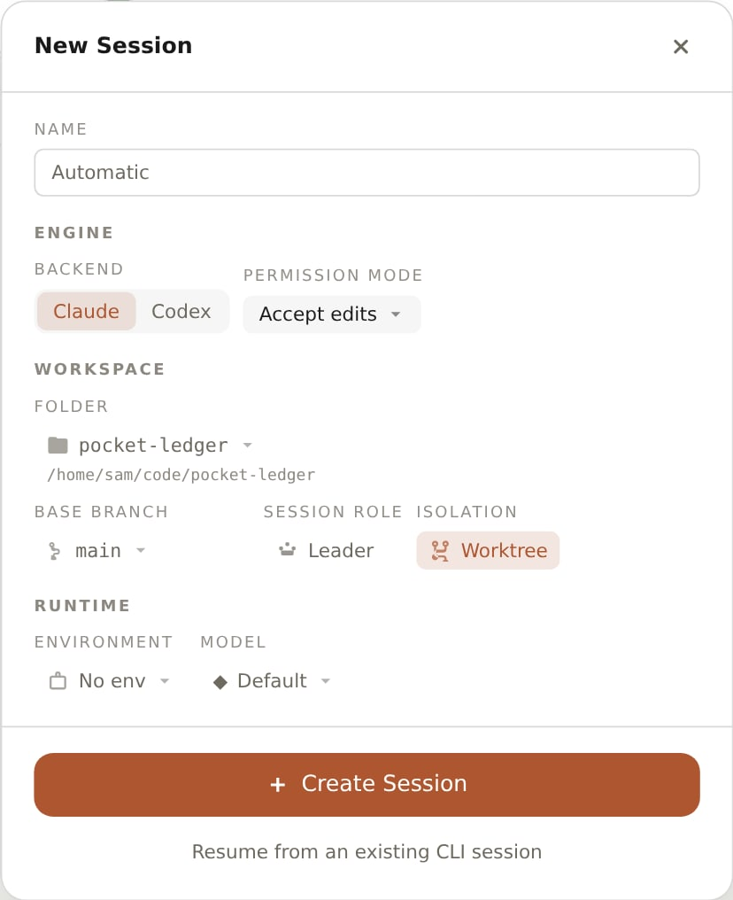
</p>

## On Your Phone

Add Takode to your phone's Home Screen over a trusted HTTPS link (for example [Tailscale](docs/tailscale-serve.md)) and follow your leaders from anywhere. Unsent drafts follow you between devices, and you can reply or dictate an answer right where the alert lands.

<p align="center">
  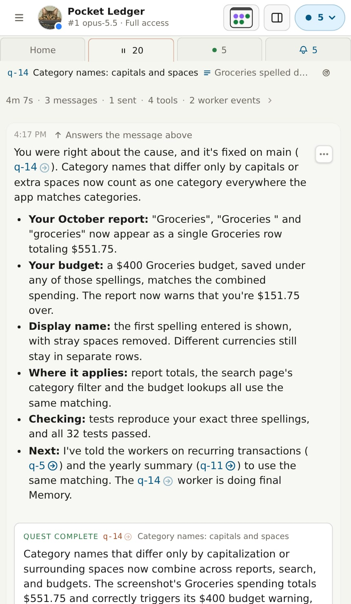
</p>

## Local Control and Integrations

Takode runs on your own machines and works with their local project directories. Your sessions, quest state, memory and history stay under your control, and there is no Takode-hosted backend to trust with your code. The model provider behind the CLI you choose remains the external service.

- **Permission controls**: agent or plan mode, with optional per-tool approvals
- **Backups**: quests, memory, settings and the Library copied to a private Git repository or another of your machines
- **VS Code integration**: Takode can install its VS Code extension, and editor selections stream into Takode while the app is open
- **GitHub Copilot**: use Copilot-served models, see [Using Takode with GitHub Copilot](docs/github-copilot.md)

---

## Quick Start

**Requirements:** [Bun](https://bun.sh) and either [Claude Code](https://docs.anthropic.com/en/docs/claude-code) or [Codex](https://github.com/openai/codex) CLI installed and already authenticated.

```bash
git clone https://github.com/MrVPlusOne/takode.git
cd takode && bun install --cwd web --frozen-lockfile
make serve
```

Then:

1. Open <http://localhost:3456>
2. Create a session
3. Choose Claude Code or Codex as the backend
4. Select the local project directory you want the session to work in
5. Start chatting, or start a leader session when you want orchestration

Takode runs locally. The only required third-party service is the model provider behind the CLI you choose. The [glossary](web/src/glossary/glossary.md) explains Takode's terms in a sentence or two each.

---

## Development

```bash
# Install web dependencies once before the first local dev run,
# and rerun after pulling dependency changes
bun install --cwd web --frozen-lockfile

# Dev server (backend :3456 + Vite HMR :5174)
make dev

# Type checking and tests
cd web && bun --no-install run typecheck && bun --no-install run test

# Production build
cd web && bun --no-install run build && bun --no-install run start
```

`make dev` assumes the `web/` dependencies are already installed. On a fresh
clone or after dependency changes, run `bun install --cwd web --frozen-lockfile`
first. See [Dependency and Install Policy](docs/dependency-policy.md) for lockfile
review, exact-version, and package update expectations.

The [Architecture & Contributor Guide](CLAUDE.md) covers how the server, frontend and backends fit together, how production builds are served, and raw protocol recording for debugging.

## Documentation

- [Changelog](CHANGELOG.md)
- [Glossary](web/src/glossary/glossary.md)
- [Using Takode with GitHub Copilot](docs/github-copilot.md)
- [Running sessions on another machine](docs/remote-hosts.md)
- [Moving the coordinator to another machine](docs/moving-the-coordinator.md)
- [Backups](docs/backups.md)
- [WebSocket Protocol Reference](WEBSOCKET_PROTOCOL_REVERSED.md)
- [Architecture & Contributor Guide](CLAUDE.md)
- [Dependency and Install Policy](docs/dependency-policy.md)
- [Feed and Thread Debugging Guardrails](docs/feed-thread-debugging.md)

## Name

Takode is named after my cat Tako. The cat portraits for leader sessions are a small nod to him, and a reminder that orchestration can still have a bit of personality.

<p align="center">
  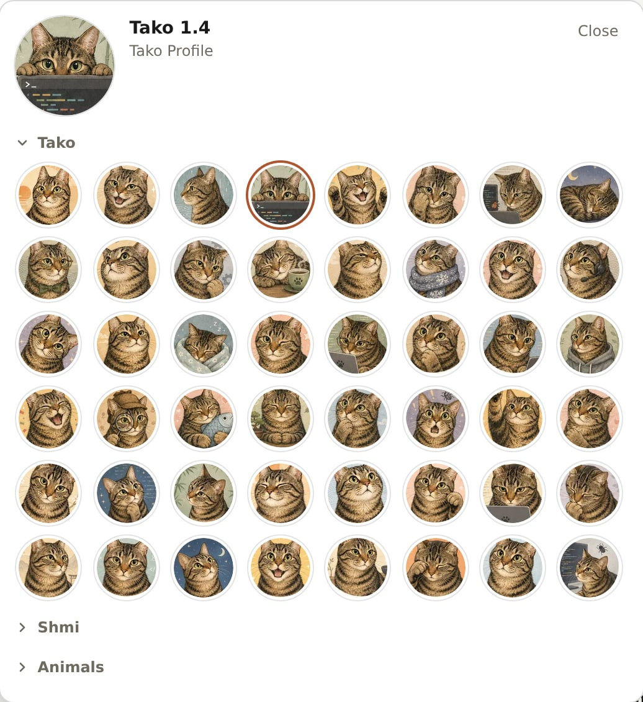
</p>

## Origin

Takode started as a fork of [The-Vibe-Company/companion](https://github.com/The-Vibe-Company/companion) and has since heavily diverged with its own architecture and feature set.

## License

MIT
