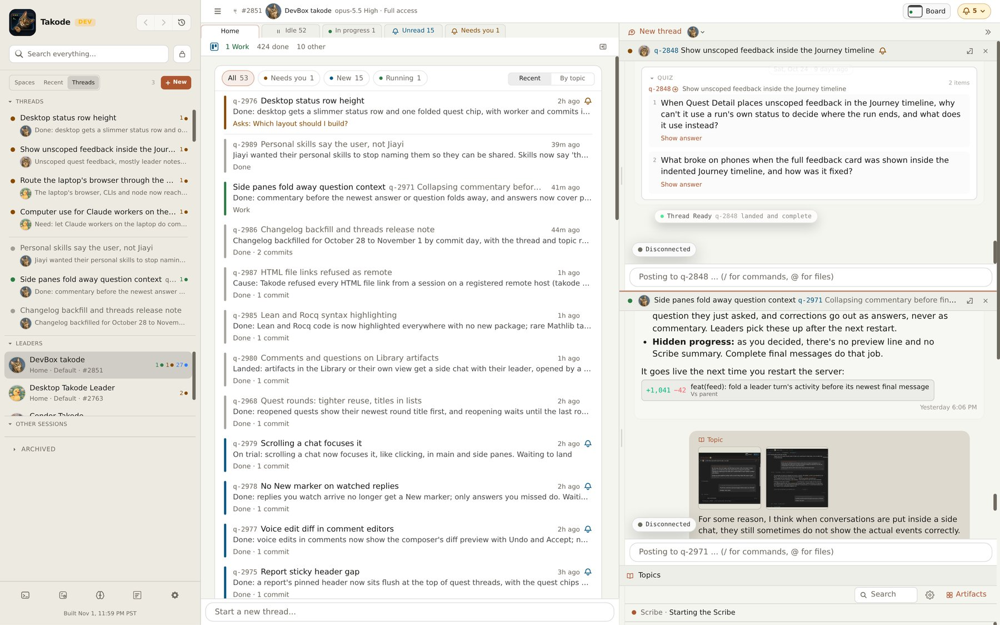
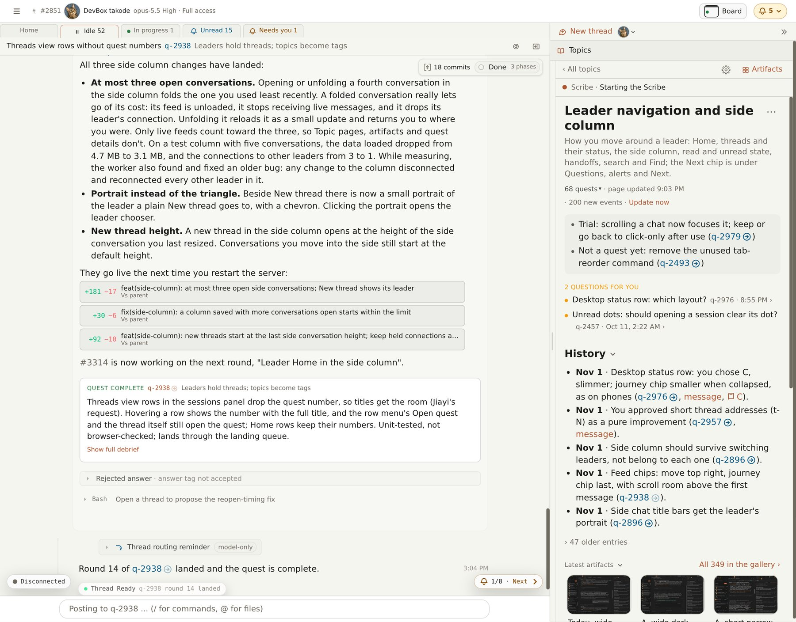

# Threads, topics and the Scribe

A Takode leader usually has several things going at once: a quest in review, a decision waiting on you, a worker halfway through something else, and a new idea you just had. All of it used to meet in the leader's Main conversation, which slowly became a drawer for everything without a home: answers about one quest arrived next to questions about another, and a decision from Monday was hard to find by Wednesday.

This release reorganizes the leader experience around one idea: **every conversation with a leader is a thread**. Threads are what you start, follow, jump between and come back to. A quieter layer of **topics**, kept by a background agent called the **Scribe**, groups them so the work stays easy to browse later.

## Threads

A thread is either a quest's thread or a lighter one started for anything else. To ask for something new, type it into the leader's **Home**, which replaces Main as the place a leader opens on. Your message starts a thread, a short name appears on its own, and the leader answers there. If the request becomes a quest, the thread simply becomes that quest's thread, so the conversation and the work stay in one place. Leaders can open threads too, for a proposal or a question that belongs to no quest yet, so it reaches you by name instead of getting lost in Main.

Threads never need closing. Home lists the leader's threads by when you last dealt with them, each with a one-line summary of its latest news, and anything waiting for your input is pinned on top. The familiar status groups (Needs you, Unread, In progress, Idle) now cover every thread, not just quests. The sessions panel's **Threads** view does the same across all your leaders in one list, so it is the quickest way back to whatever you were just doing, whichever leader it was with.

Main remains as the leader's log: its routine coordination with workers and reviewers, for when you want to see how the work was done.

## The side column

On a wide screen, the **side column** beside the conversation is a temporary workspace: a place to dock a thread while you keep working elsewhere. It holds other threads, from this leader or any other, each with its own message box, plus reports, figures and topic pages. Shift-click a thread, quest or report to open it there, or move the thread you are reading into the column with one button and go back to Home.

It is most useful while you wait. Say you asked a leader something and expect an answer within a minute or so: move that thread to the side and carry on with something else. When the leader answers or asks you a question, it appears right there beside your work, and you can reply without switching away. Once the thread is unblocked, or settles in for a long run, close it to keep the column tidy; nothing is lost, and when the work finishes it shows up under Unread like any other thread. Juggling several conversations and riding out long waits both come down to docking a thread for a while and letting it go.

The column belongs to you rather than to one leader, so it stays put while you switch leaders. One chat has the focus at a time: typing goes there, and answers in a thread you aren't looking at stay unread until you do. **New thread** at the top of the column starts a thread with any leader without leaving what you are reading.

## Topics and the Scribe

Topics are a few broad areas the work falls into. You never file anything yourself: each leader has a **Scribe**, an agent that works in the background. It names new threads, files threads and quests under their topics, writes the one-line summaries on Home, and keeps a page for each topic. When a new thread continues an earlier conversation, the Scribe joins the two, with an Undo.

A topic page answers "where does this area stand?" when you come back to it after a while. Home can also show its threads grouped by topic. To change how things are grouped, tell your leader; it passes the instruction on to the Scribe.

## Common workflows

- **Ask for something new:** type it on the leader's Home.
- **See what needs you:** the attention button in the top bar covers every leader; a leader's Needs you group covers that leader.
- **Catch up on a leader:** read the summaries on its Home, or switch Home to By topic.
- **Wait without stopping:** move a thread you are waiting on into the side column, keep working, and close it once it is unblocked; Unread brings it back when it finishes.
- **Ask another leader:** start a new thread with any leader from the side column, without leaving what you're reading.
- **Find something from last week:** the Threads view, a topic page's finished quests, or Universal Search, which now searches every message you wrote.

## Why it works this way

- **Threads, not topics, are what you jump between.** We first tried a conversation per topic, but parallel quests interleaved there and it was never clear where a new message would go. A thread has one subject; a topic works better as a label to browse by.
- **Each place has one job.** The top bar's attention button covers every session, a leader's status groups cover that leader, and Home and the Threads view help you find your way back. Lists follow what you did rather than what changed, so rows don't jump while you read.
- **Takode counts, the Scribe writes.** What needs you, what is unread and what is running come from Takode's own records, so the counts stay right even when the Scribe falls behind. The Scribe adds what needs judgment: names, topics and summaries.
- **Start light, organize later.** A thread needs no title or topic to start. Topics stay few and grow out of the work, and nothing is filed away on a timer.

The dated changelog lists each change as it landed.
